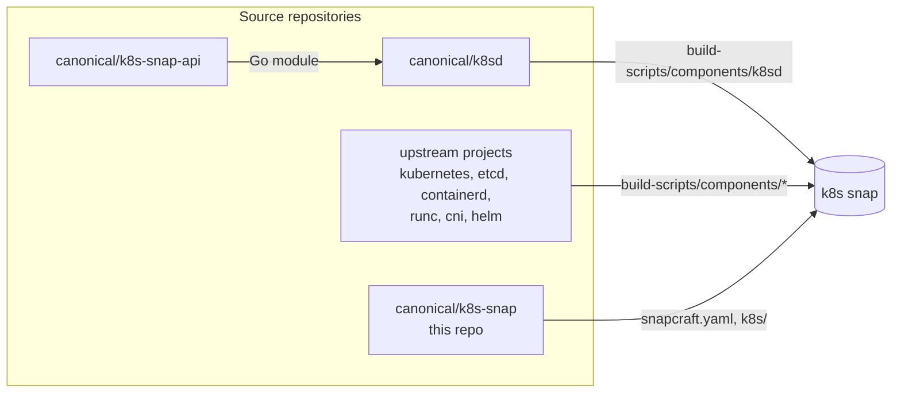
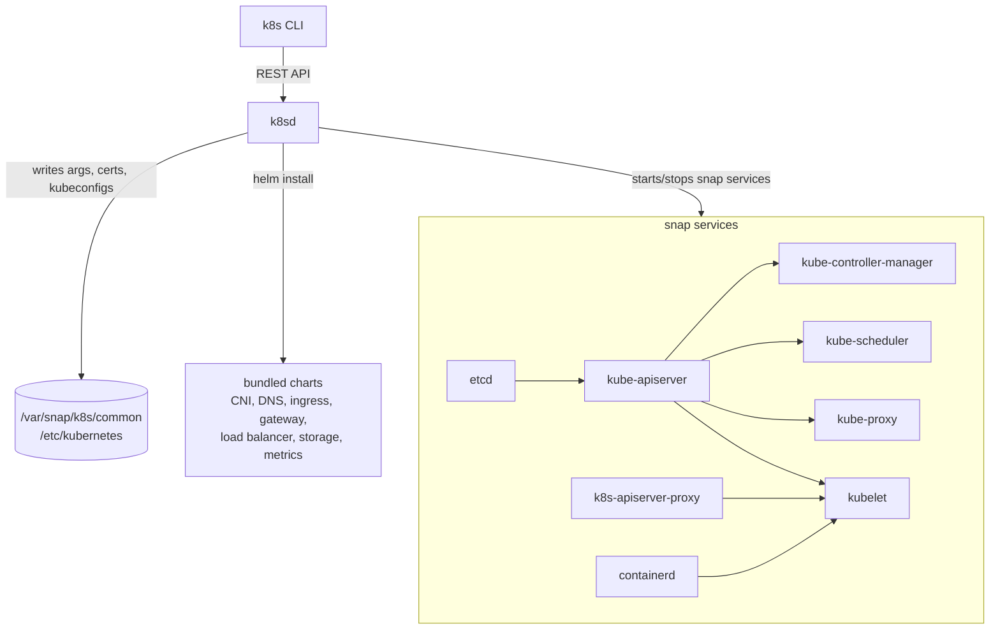

# Architecture

This document describes how the `k8s` snap is put together: where code lives,
how it is built, and what runs on a node. It is aimed at contributors. For the
user-facing (C4-style) view of the product, see
[docs/canonicalk8s/snap/explanation/architecture.md](docs/canonicalk8s/snap/explanation/architecture.md).

## Bird's-eye view

`k8s-snap` is a packaging repository. It contains very little Go code of its
own. Instead it:

1. pins upstream sources (Kubernetes, etcd, containerd, runc, CNI plugins,
   helm, k8sd) and builds them with a FIPS-capable Go toolchain,
2. wraps every binary in a small bash entry point that sets up the snap
   environment, and
3. ships the result as one snap, `k8s`, together with Helm charts and
   configuration templates.

The cluster logic (bootstrap, join, certificates, feature management) lives in
**k8sd**, which is built from a separate repository and bundled here.



| Repository | Owns |
|---|---|
| `canonical/k8s-snap` | snap definition, component pins and patches, runtime wrappers, bundled charts, integration tests, docs |
| `canonical/k8sd` | the `k8s` CLI, the `k8sd` daemon, `k8s-apiserver-proxy`, dqlite libraries |
| `canonical/k8s-snap-api` | Go API types shared by k8sd and its clients |

An API change touches all three. See [AGENTS.md](AGENTS.md) for the `replace`
directive workflow.

## Code map

```
snap/snapcraft.yaml      parts (what gets built), apps (what runs), base, arches
snap/hooks/              install, configure, pre-refresh, post-refresh, remove
build-scripts/           per-component build recipes and patch sets
  build-component.sh     clone -> pre-patch -> git am patches -> build.sh
  components/<name>/     repository, version, build.sh, [pre-patch.sh], [patches/]
  print-patches-for.py   patch-set resolution (version-tagged directories)
  generate-bom.py        bill of materials, shipped as $SNAP/bom.json
  hack/                  version bump bots, chart updaters, ELF patching
k8s/                     copied verbatim into the snap as $SNAP/k8s/
  lib.sh                 k8s::<category>::<name> bash library
  wrappers/commands/     snap app entry points (k8s CLI)
  wrappers/services/     snap daemon entry points
  args/k8sd              initial k8sd arguments, copied by the install hook
  manifests/charts/      Helm charts that k8sd deploys for built-in features
  resources/             audit policy, pod security, DISA-STIG templates
  profiles/, systemd/    containerd AppArmor profile, systemd drop-in defaults
  pebble/                service layer for running outside snapd
  scripts/inspect.sh     inspection report collector
hack/cluster-up.sh       local LXD cluster from this checkout
tests/integration/       pytest suite against real machines (LXD/Juju/Multipass)
tests/branch_management/ tests for release-branch automation
ci/                      k8s-ci Python toolkit used by GitHub Actions
docs/canonicalk8s/       Sphinx user documentation
docs/proposals/          numbered design proposals
docs/dev/fips.md         FIPS build and runtime details
.github/workflows/       CI, release, update and triage automation
.agents/skills/          agent playbooks (local cluster, inspection report, triage)
```

Each of `build-scripts/`, `k8s/`, `tests/integration/` and `docs/` has its own
`AGENTS.md` with conventions for that directory.

## Build

### Pipeline

`snapcraft --use-lxd` builds every part in `snap/snapcraft.yaml`. Go components
use `override-build: build-scripts/build-component.sh <name>`, which:

1. reads `components/<name>/repository` and `components/<name>/version`,
2. shallow-clones the tag (or branch) into the part build directory,
3. runs `pre-patch.sh` if present,
4. applies the patch set chosen by `print-patches-for.py` with `git am`,
5. runs `build.sh <install-dir> <version>`.

The patch set is the newest `patches/vX.Y.Z/` directory not newer than the
build version; a non-semver version (for example k8sd's `main`) falls back to
`patches/default/`. Add a new versioned directory when a patch needs rebasing;
do not edit an older one. Details: [build-scripts/README.md](build-scripts/README.md).

### Components

| Part | Source | Output | Notes |
|---|---|---|---|
| `kubernetes` | kubernetes/kubernetes | `bin/kubernetes` + symlinks | Patched into one multi-call binary; `kubectl`, `kubelet`, `kube-apiserver`, `kube-controller-manager`, `kube-scheduler`, `kube-proxy` are symlinks to it. Built `providerless`. |
| `k8sd` | canonical/k8sd | `bin/k8s`, `bin/k8sd`, `bin/k8s-apiserver-proxy`, `lib/*.so*`, `images.txt` | `images.txt` comes from `k8s list-images` and lists every image the snap may deploy. |
| `etcd` | etcd-io/etcd | `bin/etcd*` | ELF patched with LIEF on amd64/arm64. |
| `containerd` | containerd/containerd | `containerd`, `ctr`, `containerd-shim-runc-v2` | Patched with a side-load images plugin. |
| `runc` | opencontainers/runc | `bin/runc` | Static, built with system crypto disabled. |
| `cni` | containernetworking/plugins | CNI plugins | Patched to a single entry point. |
| `helm` | helm/helm | `bin/helm` | |
| `libmnl`, `libnftnl`, `iptables` | netfilter.org tarballs | static `iptables` | |
| `bash-utils` | Ubuntu archive | conntrack, iproute2, ipset, kmod, … | `stage-packages`, trimmed. |
| `k8s` | `k8s/` | `$SNAP/k8s/` | Copied verbatim. |
| `resources` | `k8s/resources/` | `$SNAP/etc/` | Templates copied to `$SNAP_COMMON/etc/` on install. |
| `bom` | `build-scripts/generate-bom.py` | `$SNAP/bom.json` | Runs after all components. |

The snap version is the content of `build-scripts/components/kubernetes/version`
(`kubernetes-version` part, `adopt-info`).

`build-scripts/components/pebble` and `k8s/pebble/` support running the same
payload under Pebble instead of snapd (`K8SD_RUNTIME_ENVIRONMENT=pebble`). No
part in `snapcraft.yaml` builds Pebble.

### FIPS

FIPS support is userspace only:

- Go components build with the `go/<ver>-fips` snap (a Microsoft Go fork)
  and `CGO_ENABLED=1`, and link dynamically against OpenSSL from the base snap
  (`OPENSSL_MODULES` in `snapcraft.yaml`). Build scripts set
  `GOEXPERIMENT=opensslcrypto` only for Go < 1.27.
- `runc` is the exception: static and with no crypto
  (`MS_GO_NOSYSTEMCRYPTO=1`).
- At runtime, `k8s::common::validate_env` refuses to start a service with
  `GOFIPS=1` or `GODEBUG=fips140=on` unless `/proc/sys/crypto/fips_enabled` is
  `1`.

When bumping the snap `base`, also update `OPENSSL_MODULES` and every part's
`BASE` build environment variable.

Full component table and ROCK details: [docs/dev/fips.md](docs/dev/fips.md).

## Runtime

### Processes



`snap/snapcraft.yaml` declares these apps:

| App | Kind | Enabled on install | Order |
|---|---|---|---|
| `k8s` | command | n/a | |
| `k8sd` | daemon | yes | |
| `containerd` | daemon (notify) | no | before `kubelet` |
| `etcd` | daemon | no | before `kube-apiserver` |
| `kube-apiserver` | daemon | no | before kubelet, controller-manager, scheduler, proxy |
| `kube-controller-manager`, `kube-scheduler`, `kube-proxy` | daemon | no | after `kube-apiserver` |
| `kubelet` | daemon | no | after `containerd` |
| `k8s-apiserver-proxy` | daemon | no | before `kubelet`, `kube-proxy` |

Only `k8sd` starts on install. Everything else is enabled by k8sd during
`k8s bootstrap` or `k8s join-cluster`, according to the node's role (control
plane or worker) and its datastore (bundled or external etcd).

k8sd keeps its own cluster state (membership, configuration) in dqlite via
Microcluster, under `$SNAP_COMMON/var/lib/k8sd/state`. Kubernetes state lives
in etcd. The two are separate datastores.

### Service entry points

Every service wrapper in `k8s/wrappers/services/` sources `k8s/lib.sh` and ends
in `k8s::common::execute <name>`, which:

1. sets `PATH`, `LD_LIBRARY_PATH` and locale to the snap's `current` revision,
2. reads arguments from `$SNAP_COMMON/args/<name>` (one flag per line),
3. reads environment from `$SNAP_COMMON/args/snap-env`, then
   `$SNAP_COMMON/args/<name>-env` (service-specific wins),
4. runs the FIPS check,
5. `exec`s `$SNAP/bin/<name>`.

k8sd writes those argument files, so the files under `$SNAP_COMMON/args/` are
the effective configuration of every Kubernetes service. The only default
shipped in the snap is `k8s/args/k8sd`.

Some wrappers do extra work before `execute`. For example, `containerd` loads
its AppArmor profile and re-execs unconfined, and `kubelet` waits for the
containerd socket and the API server `/readyz`.

### Filesystem

| Path | Content |
|---|---|
| `$SNAP` (`/snap/k8s/current`) | read-only binaries, `k8s/`, charts, `bom.json` |
| `$SNAP_COMMON/args/` | service arguments and environment files |
| `$SNAP_COMMON/etc/configurations/` | user-editable copies of `k8s/resources/` |
| `$SNAP_COMMON/var/lib/k8sd/state` | k8sd / dqlite state |
| `$SNAP_COMMON/run/containerd.sock` | containerd socket |
| `/etc/kubernetes/` | PKI and kubeconfigs (`admin.conf`, `kubelet.conf`, …) |

### Snap lifecycle hooks

| Hook | Action |
|---|---|
| `install` | copy resource templates, disable snapd config sync, seed `$SNAP_COMMON/args/k8sd` |
| `configure` | `k8s x-snapd-config reconcile`, containerd systemd defaults, drop kube-apiserver feature gates unknown to this version, migrate DISA-STIG resources |
| `pre-refresh` | disable snapd config sync until k8sd has resynced |
| `post-refresh` | block the refresh if the removed k8s-dqlite datastore holds data; touch `$SNAP_COMMON/lock/post-refresh` so k8sd runs its own post-refresh logic once it is up |
| `remove` | `k8s x-cleanup` for containers, network and containerd; remove sysctl overrides, pod logs and resources |

Hooks run before k8sd is reachable, so any work that needs the cluster is left
to k8sd, signalled with a lock file or reconciled later.

### Features

Built-in features (network, DNS, ingress, gateway, load balancer, local
storage, metrics server) are Helm charts in `k8s/manifests/charts/`, deployed
and configured by k8sd. Chart versions are bumped by the
`build-scripts/hack/update-*-chart.sh` scripts. The container images they
reference are listed in k8sd's `images.txt`.

## Flavors and branches

| Branch | Content |
|---|---|
| `main` | development; `latest/edge` |
| `release-1.XX` | supported release; `1.XX-classic/*` channels |
| `autoupdate/strict`, `autoupdate/release-1.XX-strict` | strict-confinement flavor, kept in sync with their base branch by automation |
| `autoupdate/sync/<branch>` | bot PRs bumping component versions |

`main` is `confinement: classic`. The strict flavor is a set of patches on top,
held in the `autoupdate/*-strict` branches. Strict-only code paths are gated at
runtime by `k8s::common::is_strict`, at build time by `STRICT` in
`print-patches-for.py`, and via strict-only patch sets such as
`components/runc/strict-patches/`. `k8s/hack/connect-interfaces.sh` connects
the snap interfaces a strict install needs.

Channels follow `{major}.{minor}-{flavor}/{risk}`; see [AGENTS.md](AGENTS.md).

## Testing and CI

| Layer | Where | Entry |
|---|---|---|
| Integration | `tests/integration/` | `tox -e integration`; real snap on LXD, Juju or Multipass; tests select by `@pytest.mark.tags` |
| Docs | `docs/spread.yaml` | Spread runs commands embedded in docs |
| Branch automation | `tests/branch_management/` | tox |
| Local repro | `hack/cluster-up.sh` | LXD cluster from a locally built snap |

Main workflows in `.github/workflows/`:

- `lint_and_integration.yaml`: PR gate; builds amd64/arm64 via
  `build-snap.yaml` and runs `e2e-tests.yaml` with the `pull_request` tag,
  widened to `up_to_weekly` when a PR touches `tests/` or targets a
  `release-*` branch. Also runs charm e2e and security scans.
- `nightly-test.yaml`: `up_to_nightly` across Ubuntu releases, architectures
  and published channels.
- `weekly-test.yaml`: `up_to_weekly` on Pro FIPS/STIG Multipass VMs, CNCF
  conformance, and docs link checks against published channels.
- `update-components.yaml`: daily `update-component-versions.py` across `main`
  and supported release branches; opens auto-merge PRs.
- `cut-release-branch.yaml`, `update-pre-release-branches.yaml`, `backport.yaml`:
  release branch management.
- `sbom.yaml`, `trivy.yaml`, `semgrep.yaml`, `security-scan.yaml`,
  `scorecard.yaml`, `zizmor.yaml`: supply-chain and security scanning.
- `triage.yaml`: the issue triage bot (see `.agents/skills/triage/`).

Shared CI logic is in the `ci/` Python toolkit (`ci/k8s-ci.py` subcommands).

## Invariants

- A Go change reaches a node only through a snap rebuild. Patches live in
  `build-scripts/components/*/patches/`, never in a vendored copy.
- Wrappers are thin. Configuration decisions belong in k8sd; wrappers only
  prepare the environment and `exec`.
- `lib.sh` functions are namespaced `k8s::<category>::<name>`.
- Binaries with crypto are dynamically linked against OpenSSL. A new component
  must be classified in [docs/dev/fips.md](docs/dev/fips.md).
- Service start order is declared in both `snap/snapcraft.yaml` (`before`/
  `after`) and `k8s/pebble/000-k8s.yaml`. Keep them consistent.
- Non-trivial features start with a proposal in `docs/proposals/`.
